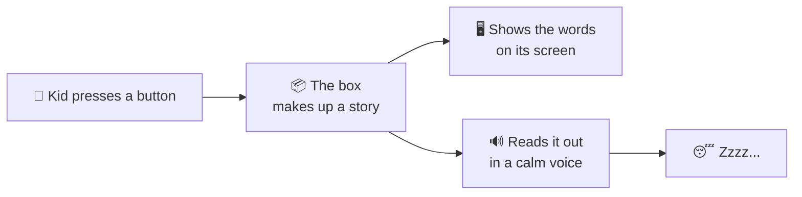
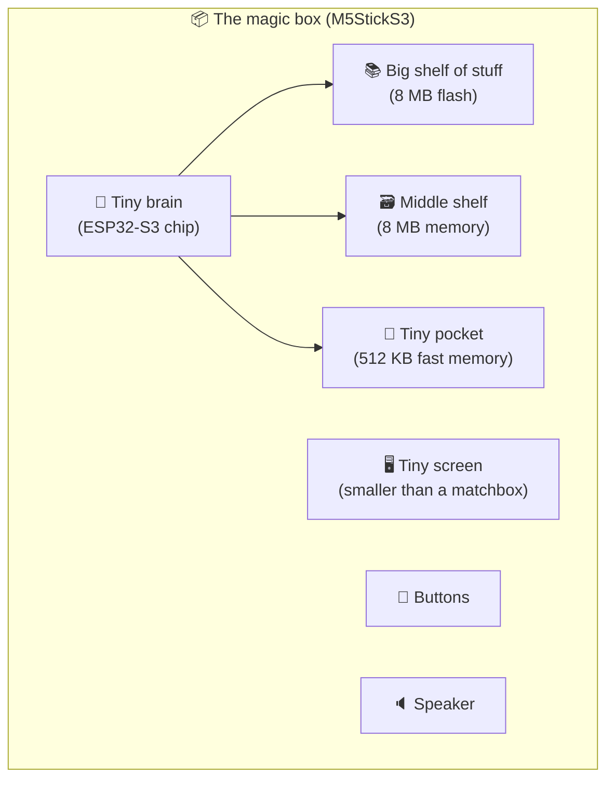
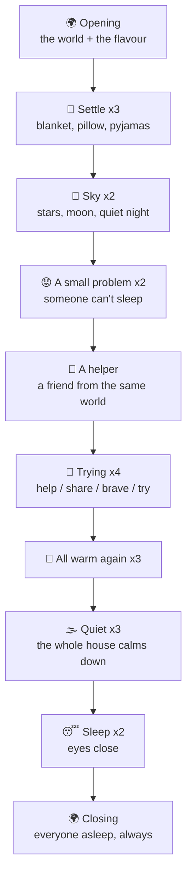
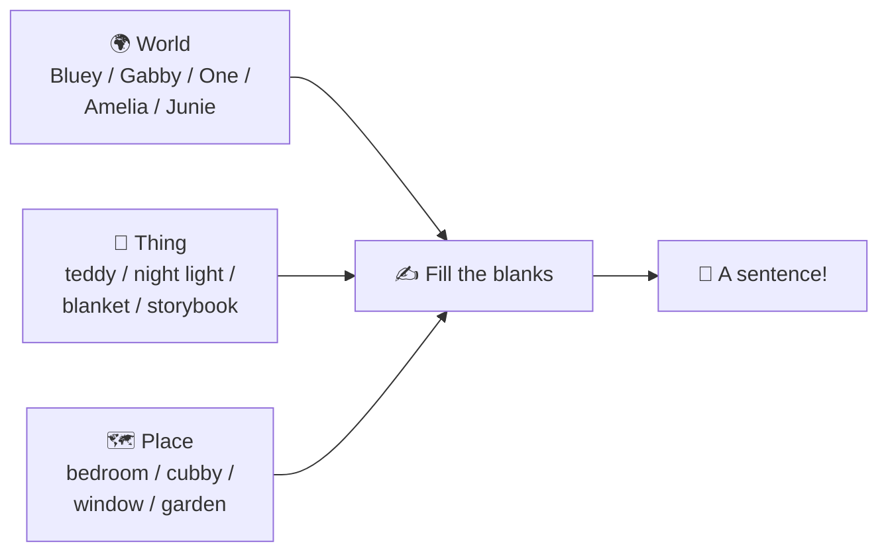
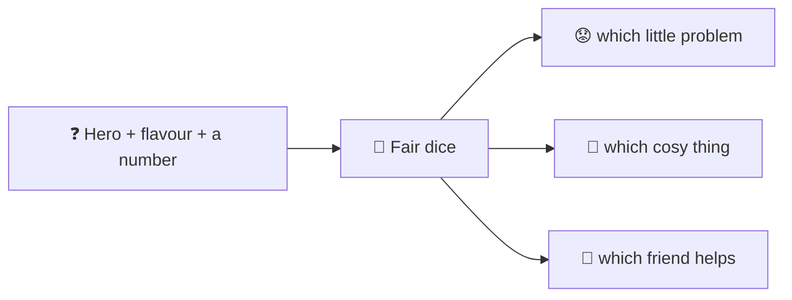
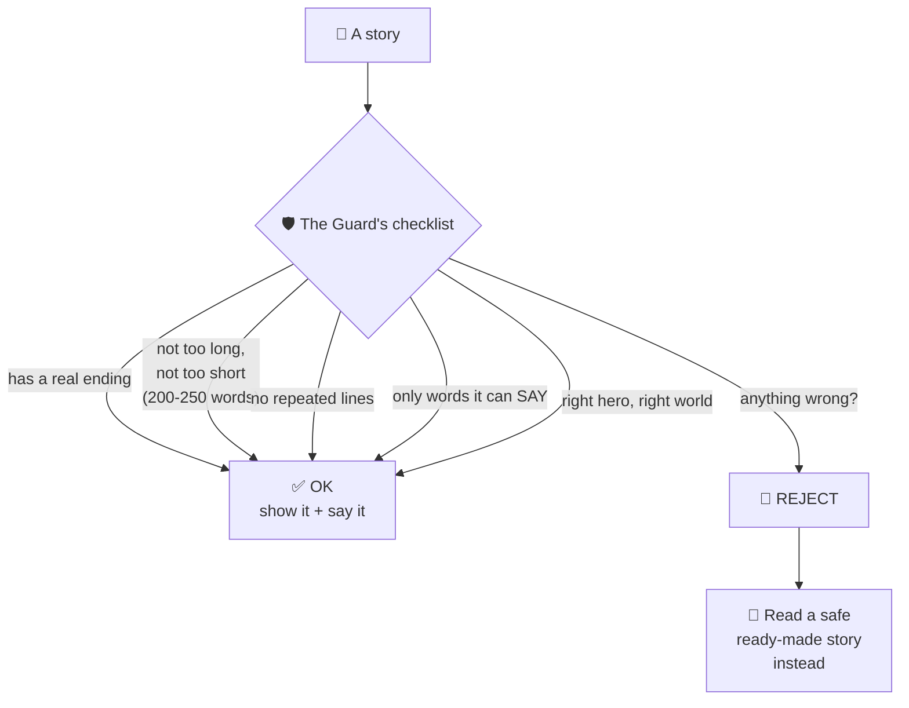
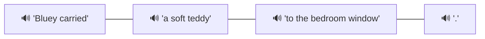
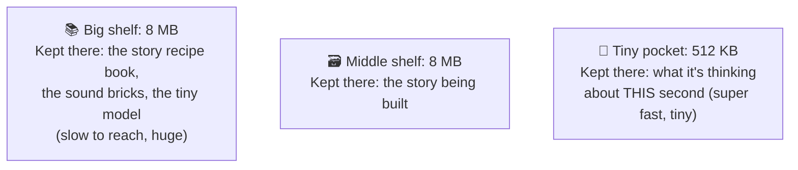
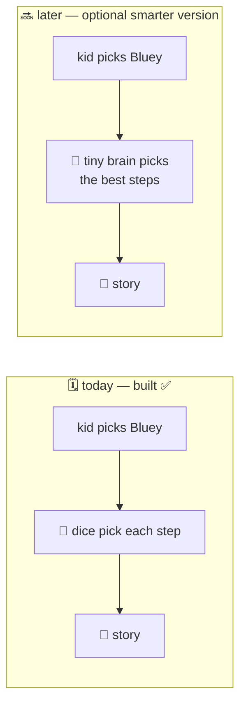

# What is this thing? (Explained like you're 5)

Imagine a little toy box with a screen, two buttons and a speaker, sitting on
your bedside table. You press a button to pick your favourite character — like
Bluey — and the box makes up a brand-new bedtime story about them, shows it on
the screen, and reads it out loud in a calm voice until you fall asleep.

The important part: the box never talks to the internet. Not ever. Not once
after it's built. Like a bedtime book, but one that can write itself.

## 1. The box is really, really tiny

Inside the box is a computer chip smaller than your fingernail. It's not a big
computer like a laptop. It has:

That's why everything has to be small and clever. One whole movie is already
too big for the entire box. A big AI brain? Forget it. So we cheat — cleverly.

## 2. How long is a bedtime story?

Long enough to fall asleep to, short enough to finish:

| | |
|---|---|
| Words | **200–250** |
| Lines (sentences) | about **22** |
| Reading time | about **2 minutes** |
| On the screen | about **3 pages**, turned one line at a time |

## 3. How does the box "invent" a story? It follows a bedtime recipe.

The box can't "think up" stories the way you do. It builds one like a recipe.
Every story walks the same sleepy path, and the box picks each step from a
little pile of choices:

The important bit: the **sleepy ending always comes last**. No matter which
flavour you pick — adventure, funny, kind — the story still ends with everyone
fast asleep. That's what makes it a bedtime box.

It then fills in the blanks, like a colouring book:

> "{hero} carried {thing} to the {place}." becomes

> "**Bluey** carried **a soft teddy** to **the bedroom window**."

## 4. How does it pick? By rolling fair dice, the same way every time

The box has fair dice inside. Same question, same dice roll, same story. That's
a superpower: if a story is wrong, we can find it again, exactly, until we fix
it.

## 5. Before the box says anything, a Safety Guard checks it

There's a guard standing at a gate inside the box. Every story must pass the
guard's checklist before it can be shown or spoken:

The most important check is the **word stamp**: the box only allows words it
knows how to say (722 words today). So "Bluey found a knife" can never get
through, because "knife" has no stamp — even though the sentence shape is
perfect.

## 6. How does it talk? With LEGO voices, not a robot brain

A talking robot brain is WAY too big for our tiny box. So instead a friendly
voice is recorded **before** the box is built: little sound bricks like
*"Bluey carried"*, *"a soft teddy"*, *"to the bedroom window"*.

When the story is ready, the box snaps the right bricks together:

That's about 218 little sound bricks (~4 minutes of recorded voice, ~2 MB). The
bricks fit on the big shelf, and each story borrows about 890 kB of them as it
plays. It sounds like a nice person reading — not a robot.

## 7. Where does the tiny computer "think"? On three shelves

Everything big lives on the big shelf. The box only holds a tiny bit in its
pocket at once — like reading a book one page at a time instead of carrying the
whole library on your head.

## 8. So where does the "tiny language model" (the AI part) go?

Right now the recipe-picker is just fair dice 🎲 (built and tested over 15,360
stories). Later we can swap the dice for a tiny brain 🧠 — but one that only
**picks the recipe steps, never writes the words**:

That's the trick that keeps everything safe: the brain can't say a bad word
because it doesn't know words — it only knows recipe steps. The guard still
stands at the gate. The voice bricks always fit.

## 9. What's finished and what's not

| | Done? |
|---|---|
| The recipe book + the dice + the guard | ✅ 327 checks green, 15,360 stories |
| Five bedtime worlds (Bluey, Gabby, One, Amelia, Junie) | ✅ in the code |
| Story data for the tiny brain | ✅ 2,880 stories, all different |
| The real box (screen, buttons, speaker) | ❌ needs the actual toy + tools plugged in |
| The ~218 sound bricks | ❌ needs you to read ~218 lines out loud |
| The optional tiny brain | ❌ last, after all of that |

## Grown-up note (the boring part)

The five worlds (Bluey, Gabby's Dollhouse, Numberblocks, Amelia Bedelia, Junie
B. Jones) each belong to the company that owns them. For a toy **you** build
and keep at home, that's fine. It would not be fine to sell it without asking
those companies, so we keep a note of who owns what in the code, so a "for
everyone" version can simply leave those worlds switched off.
