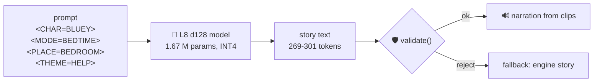
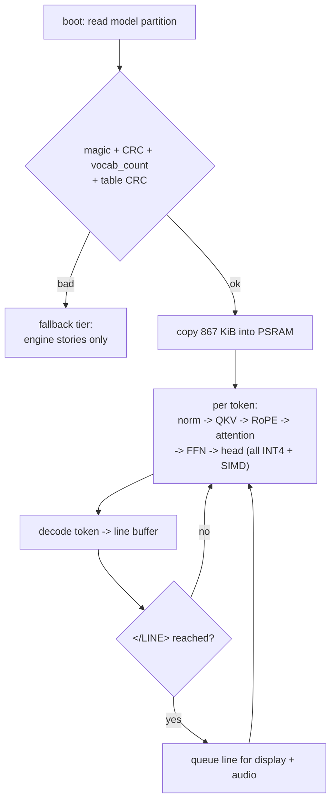
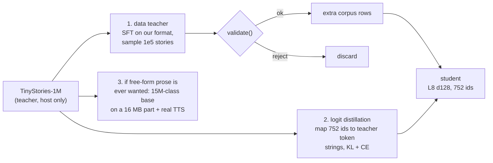

# The tiny language model

What the model is, what it is allowed to say, how big it is, and how it runs on
an ESP32-S3 with 8 MB flash and 8 MB PSRAM. Every number here is either
measured from this repository or computed from the shapes below - nothing is
quoted from a paper.

Status: **trained from scratch and measured.** 4,000 CPU steps bring masked
cross-entropy from 2.97 to 0.29 and 19 of 20 sampled stories pass the firmware
validator (section 9). The engine's dice remain the fallback tier, and
`training/sample.py` is the harness that measures both.

## 1. Job description

The model does not decide *what a story is*. The story is a sleep spine of
phases (settle, sky, problem, help, try, warm, quiet, sleep) built from the
world tables in `story_engine.cpp`. The model's job is to fill that spine:



Two possible jobs, same architecture family:

| | A. Beat selector | B. Word-level line generator |
|---|---|---|
| Emits | one id per phase (24 ids) | the story text, token by token |
| Params | ~50 K | 1.67 M |
| Guarantee | every choice is narratable | every word is narratable (closed vocabulary) |
| Beats the dice at | combination taste | combination taste, phrasing, ordering |

**Build B, keep the engine as the fallback tier.** A is nearly free but adds
little over the deterministic dice; B is what "a tiny language model on the
device" means.

## 2. The token table is the safety boundary

`make vocab` writes `data/vocab.json`, generated from the same tables that
build the stories:

```text
count 752 = 30 control tokens + 722 words
  <PAD> <BOS> <EOS> <END> <LINE> </LINE>
  5 x <CHAR=..>   4 x <MODE=..>   11 x <PLACE=..>   4 x <THEME=..>
  722 words: every word the spine, the worlds and the slot values can produce
```

Measured over all 2,880 corpus stories:

| | |
|---|---|
| Tokens per sequence (prompt + story) | **258-299**, median 277 |
| Tokens per story (output only) | **253-295**, median 272 |
| Out-of-vocabulary tokens | **0** |

Consequences that drive everything else:

1. **A model that can only emit these 752 ids cannot emit a word without a
   narration asset.** The validator's `unapproved_word` rule degrades from a
   content guard to a corruption guard.
2. **The output head is tiny.** 752 x 128 = 96 K multiply-accumulates per
   token, against 32 K x 128 = 4.2 M for a 32 K BPE head - 44x cheaper. In the
   published ESP32-S3 prior art the output head was 67 % of token time.
3. **The context budget is measured, not guessed:** 384 tokens covers the
   worst observed sequence (299) with 22 % headroom.

Encoding rule (the whole tokenizer): control tokens for the prompt and the
line markers; words by `normalize_word()` lookup (letters only, lowercased, so
punctuation disappears into `</LINE>`); an unknown word is a hard error, not a
byte fallback.

**Case is presentation, not vocabulary.** The table holds one form per word, so
the model cannot emit "Bluey" and "bluey" as different tokens and cannot waste
capacity on case variants. The renderer restores the sentence-initial capital,
the full stop and the cast names (read from `data/series.json`, so a story only
ever capitalises its own world's cast). Measured cost of the alternative: the
corpus contains just **58** distinct capitalised forms, so a case-preserving
table would be 722 -> 759 words (+37 ids, +4.7 K params) and would remove the
renderer rule entirely. That is the planned follow-up; the two cosmetic
artifacts of the interim rule are the Numberblocks number-words (where "one"
is both a name and an ordinary word) and "Mrs Rogers" losing its period.

## 3. Architecture

Tied input/output embeddings, RoPE (no learned position table), pre-norm, GELU
FFN, no biases except attention projections kept for quantisation simplicity.

Recommended: **layers 8, d_model 128, heads 8 (head dim 16), FFN 512,
vocal 752 (30 control + 722 words), context 384, tied embeddings, INT4 weights
group-size 64 with FP16 scales, INT8 KV cache.**

| Tensor | Shape | Params |
|---|---|---:|
| `tok_emb` (tied with the output head) | [752, 128] | 96,256 |
| per layer x8: `wq wk wv wo` | [128, 128] each | 65,536 |
| per layer x8: `w1` [128, 512], `w2` [512, 128] | | 131,072 |
| per layer x8: `attn_norm`, `ffn_norm` FP16, 4 attention biases FP16 | | 384 |
| `final_norm` | [128] FP16 | 128 |
| **total** | | **1,671,296** |

Cost at 4.25 bits per weight (4-bit payload + FP16 scale per 64 weights):

| | |
|---|---|
| Weights in flash | **867 KiB** |
| Norms and biases (FP16) | ~7 KB |
| KV cache, INT8, context 384 | **768 KB** |
| Activations (SRAM) | ~5 KB (x[128], hidden[512], logits[752], scores[384]) |
| Prefetch buffer (PSRAM) | 16 KB |

Alternatives, computed the same way:

| Config | Params | INT4 flash | KV INT8 | Story (301 tokens) |
|---|---:|---:|---:|---:|
| L2 d64 h4 ffn192 | 0.13 M | 68 KiB | 96 KiB | 0.2-1.0 s |
| L4 d96 h6 ffn288 | 0.44 M | 229 KiB | 288 KiB | 0.7-3.5 s |
| L6 d128 h8 ffn384 | 1.08 M | 561 KiB | 576 KiB | 1.7-8.6 s |
| **L8 d128 h8 ffn512** | **1.67 M** | **867 KiB** | **768 KiB** | **2.7-13.3 s** |
| L12 d128 h8 ffn512 | 2.46 M | 1.25 MiB | 1.13 MiB | 3.9-19.6 s |

Flash after shipping it: app ~2.25 MB + model 0.87 MB + voice ~2 MB = **5.12 of
8 MB**, about 2.9 MB spare.

## 4. Training

The tokenizer needs no training (word level). The corpus comes from the engine:

```bash
./build/storygen --corpus data/processed/train.jsonl --variants 240   # 57,600 stories
```

The end-to-end pipeline — corpus generation, packing, the training loop, the Modal
GPU run, evaluation and measured results — is documented in [`training.md`](training.md).

| | |
|---|---|
| Sequences | 57,600, all distinct |
| Tokens | ~16.0 M (277 per sequence) |
| Batch | 32 sequences x 384 = 12,288 tokens/step |
| Steps per epoch | ~1,336 |
| Optimiser | AdamW, lr 3e-4 cosine, 100 warmup, weight decay 0.1 |
| Epochs | 3-6 |
| Objective | causal next-token prediction over prompt + story |

Evaluation is the repo's own harness, not perplexity: `validate()` pass rate
(target 100 %), repeated-line rate, world-anchor rate, beat-coverage, and the
fixed prompt list from the plan. A model that scores 100 % and reads worse than
the dice has failed.

**The honest ceiling:** trained on the engine's own templates, the model learns
the template distribution. It beats the dice at *choice* (which beat, in which
order, for which prompt) but cannot invent new sentences. Real freshness comes
from authoring more beats, props, casts and worlds - the corpus generator then
scales for free. If a genuinely creative model is wanted later, the lever is
Per-Layer Embeddings (a large flash-resident table read sparsely), which is how
the published 28.9 M-parameter port fits a 16 MB part, not more layers here.

## 5. Runtime on the device



Two placement options, both measured against the narration budget:

| Placement | Read per token | Per story (301 tokens) |
|---|---|---|
| Flash-mapped (`esp_partition_mmap`) | 867 KiB at 20-40 MB/s | 6.5-13.3 s |
| **PSRAM-resident (recommended)** | 867 KiB at ~60-100 MB/s | **2.7-4.5 s** |

Narration of the same story takes **111 s**, so generation is 25-40x faster than
playback: the device can generate line by line, far ahead of the speaker, which
is exactly what the audio continuity requirement needs.

**The engine renders; the model only chooses.** A generated line is a *draft*.
The runtime matches it against the engine's beat inventory for that prompt
(`engine_lines()` - every beat of every phase the prompt can use, filled with
every prop and friend that world allows: 3,000-4,500 lines) and shows the
engine's own text:

| Match result | What the device does |
|---|---|
| exact word match | shows the engine line, so punctuation and capitals are restored |
| within 3 word edits ("tucked themselves in **the shelf**" vs "in **for the night**") | repaired to the engine line |
| no match | resample the line once, then the engine's fallback tier |

Measured on 20 sampled stories: **20/20 pass the validator, 456/457 lines
(99.8 %) are word-exact engine lines, 1 line (0.2 %) needs the fallback tier.**
The inventory lookup also rejects a beat written for the wrong theme, because
the theme-scoped pools are not in the inventory of another theme.

Implementation notes:

* Keep only activations, KV, norms and biases in RAM; weights are read-only.
* INT8 activations x INT4 weights, dequantised on the fly; use the PIE SIMD
  int8 dot product (`ee.vmulas.s8.xacc`) or `esp-dsp` kernels - 2-4x over
  scalar. The plan's component list omits both.
* Prefetch the next layer's weights (16 KB double buffer) while computing the
  current one.
* The host reference now decodes with a **KV cache** (`KVBuf`, `generate_story_cached`):
  prefill the prompt once, then one token per step, with a rejected line undone by
  restoring the cache length and the pending logits. Verified numerically
  equivalent to the full-recompute path (worst logit difference 1.7e-5 over
  prefixes of 2-33 tokens; greedy stories identical token for token) and measured
  at **2.1x** wall-clock on the host (0.79 s -> 0.37 s for a 272-token story).
  The FLOP reduction is larger (uncached decoding costs ~n/2 times more) but at
  this size Python dispatch dominates, not arithmetic. On the device the cache is
  not an optimisation but a requirement: without it every decoded token would
  re-read all 867 KiB of weights n times, ~243 MB of flash traffic per token at
  n=280 [projection, not measured - the firmware is not built].
* `temperature 0` is greedy and deterministic, which is what the equivalence test
  and any device/host comparison should use.
* Canonicalise before display and before narration: it is what guarantees that
  a line maps to a clip and that punctuation survives the letters-only table.
* Sampling rules, in the order they matter: stop on `<END>`; **mask `<EOS>`**
  (it is a training-data tail, and leaving it in lets an undertrained model
  truncate a story mid-line); generate **one line at a time** and resample a
  line that duplicates an earlier one, because the validator rejects duplicate
  lines; temperature 0.7-0.9 with top-k 40 or top-p 0.9.
* Single arena allocation, no allocation in the decode loop;
  `heap_caps_get_largest_free_block` after load is the number to watch.

## 6. Failure handling

| Failure | Behaviour |
|---|---|
| Header magic, CRC or `vocab_count` mismatch | model disabled, engine-only mode, UI says so |
| No `<END>` before the token budget | line buffer discarded, engine fallback story |
| `validate()` rejects anything | engine fallback story |
| Line has no narration mapping | text kept, that line is skipped in audio, engine fallback for the rest |
| Generation slower than playback | playback drains, generation continues; the audio task has priority |

The model is never the safety boundary. The validator is, and the engine can
always produce a complete, narratable story without the model.

## 7. What to measure on hardware

1. Largest free PSRAM block after model load (target > 3 MB free).
2. ms/token in both placements, and tokens/s over a full story.
3. Audio underruns while generating at full speed (target: zero).
4. Heap and PSRAM after 20 consecutive stories (leak/fragmentation check).
5. Validator pass rate over 100 generated stories, and the fallback rate.
6. Temperature and battery draw during 30 minutes of stories.

## 8. Why not fine-tune TinyStories-1M

Fine-tuning a model that already speaks English is a sound instinct, and it is
the right move for a *bigger* ambition. For this device it fails on the output
channel, not on quality. Verified config of `roneneldan/TinyStories-1M`:

| | |
|---|---|
| Architecture | GPT-Neo, `hidden_size` 64, 8 layers, 16 heads of dimension 4, alternating global/local attention (window 256), 2048 learned position embeddings |
| Tokenizer | GPT-2 byte-level BPE, 50,257 tokens, byte fallback (the model card uses `EleutherAI/gpt-neo-125M`'s tokenizer) |
| Parameters | **~3.75 M, head tied**: wte 3.22 M + wpe 0.13 M + body 0.40 M |
| Tied? | verified from the checkpoint: `GPTNeoConfig` defaults to `tie_word_embeddings=True`, the model card's config does not override it, and **the published `pytorch_model.bin` contains no `lm_head.weight` key** (124 tensors: 67 weights + 57 biases/masks) |
| Published weights | 48,580,813 bytes = **14.98 MB of FP32 weights + 33.55 MB of persistent bool causal-mask buffers** (`transformer.h.N.attn.attention.bias`, 8 x 2048 x 2048). 14.98 + 33.55 = 48.53 MB, which matches the file to 0.02% |
| INT4 footprint | **~2.0 MB** of weights once the masks are dropped, as a real export would |
| Flash check | 2.25 app + 2.0 model + 2.0 voice = **6.25 of 8 MB**, ~1.75 MB margin. Size alone does not disqualify it |
| Licence | no licence tag on the model card as published - verify before redistributing weights |

Three concrete costs:

1. **The output head costs more than our entire model.** 50,257 x 64 = 3.2 M
   multiply-accumulates per token, versus 1.67 M for the whole L8 d128 model
   and 96 K for our 752-id head. In the published ESP32-S3 port this head was
   67 % of token time.
2. **The runtime is a different runtime.** Two attention variants, learned
   absolute positions, and head dimension 4 (not a good SIMD shape) - versus
   the plain RoPE transformer already specified. More kernels, more bring-up
   risk, for a model we cannot narrate.
3. **The blocker: byte-level BPE cannot be spoken by a clip library.** V1
   narration is ~218 recorded phrases keyed to the engine's templates, and the
   `unapproved_word` rule exists because a word with no clip is unusable. A
   50,257-token byte-fallback model can emit any string, so most stories would
   drift outside the approved vocabulary and be rejected - or would need real
   neural TTS, which section 4 of the plan excludes from V1. Fine-tuning
   teaches it our format quickly; the format was never the hard part.

At ~2.0 MB tied it *would* fit the flash budget. What rules it out as firmware
is items 1 and 3, not size.

**How to use it anyway** - three legitimate routes, cheapest first:



Route 1 needs no runtime change and reuses the validator already built: the
teacher supplies surface variety, the engine still owns the format, and the
student still ships as 867 KiB with a closed vocabulary. Route 2 is stronger
when the corpus is small. Route 3 is a different device with a different
narration story.

**Why from-scratch is defensible here.** The task is not English. With a closed
722-word table and a fixed spine, the model has to choose ~22 beats from pools
of 5-10 and emit their exact surface form; the grammar is a non-problem.
What buys quality is the content inventory (beats, props, casts, worlds),
which the corpus generator scales for free: `--variants 240` already yields
57,600 distinct stories / 16.0 M tokens. Teacher-written rows are a useful
*addition* to that corpus, not a replacement for the architecture.


## 9. Measured: from-scratch runs

Two runs, same architecture and same runtime path, differing only in corpus and
compute. 100 sampled stories each (5 worlds x 4 themes x 5 repeats):

| | CPU, 4,000 steps, 2,880-story corpus | **Modal T4, 5,400 steps, 57,600-story corpus** |
|---|---|---|
| Masked val loss | 0.290 | **0.267** |
| Validator pass rate | 97/100 | **100/100** |
| Lines word-exact to an engine line | 99.3 % | **99.7 %** |
| Lines outside the prompt's inventory (drift or wrong theme) | 0.88 % | **0.13 %** |
| Wall clock | 659 s (CPU) | 1,344 s (T4, batch 64) |

The 6.8x drop in out-of-inventory lines is the one that matters: those are the
only lines the engine's fallback tier has to cover. Everything above 99.7 % is
the canonicaliser's floor, not the model's remaining error.

### The first run in detail

Trained on this repository's corpus with `training/train_model.py`, on CPU
(macOS arm64, PyTorch 2.14.1, NumPy 2.5.3), loss masked to the story tokens:

| | |
|---|---|
| Model | L8 d128 h8 ffn512, tied, ctx 384 - **1,671,296 params**, 867 KiB INT4, 768 KiB KV |
| Data | 2,880 stories / ~0.8 M story tokens, 16 per batch |
| Schedule | AdamW, lr 3e-4 OneCycle with 100 warmup steps, grad clip 1.0 |
| Run | **4,000 steps in 659 s** (6.1 steps/s on CPU) |
| Loss (masked CE) | train 2.970 -> 0.260, val 2.949 -> 0.290 |
| Validator | **19/20 generated stories passed `storygen --check`** (97/100 at the 100-story sample) |

```
step   250  train 2.970  val 2.949   step  2000  train 0.293  val 0.314
step   500  train 0.821  val 0.810   step  3000  train 0.266  val 0.295
step  1000  train 0.409  val 0.419   step  4000  train 0.260  val 0.290
```

The one failure was a duplicate line, which the line-level resample rule now
catches. Remaining quality gap at this size: the model occasionally drifts
*inside* a beat ("tucked themselves in the shelf" instead of "in for the
night"). The validator cannot see that, because every word is approved - it is
fixable only with more data or more parameters, and it is the honest ceiling
described in section 4.

Three numbers, not one, because a pass rate cannot see drift:

| Metric | Measured |
|---|---|
| Validator pass rate | **20/20** in a fresh sample (19/20 in the run above) |
| Word-level fidelity: generated line == an engine line | **455/459 = 99.1 %** |
| Lines needing punctuation restoration from the engine text | ~35 % of matched lines (the table is letters-only) |

The apparent 66 % fidelity in an earlier measurement was a metric bug on our
side: it compared the model's punctuation-free output against the corpus text.
Punctuation is a renderer concern, so the metric now compares words only.

Reproduce:

```bash
make corpus vocab
.venv/bin/python training/prepare_data.py
.venv/bin/python training/train_model.py --steps 4000          # CPU, ~11 min
.venv/bin/python training/sample.py --per-world 4
```

Or on a GPU: `modal run training/modal_train.py --steps 5400 --batch 64`
(same `train_from_packed()` core; see `training/README.md`). The GPU trains
only - canonicalisation and validation stay on the host, where the engine
binary lives.

---

## 10. Scaling the vocabulary

Everything the vocabulary touches is one tensor: the tied input/output embedding
`[vocab, 128]`. The 8 blocks, the final norm, the context and the KV cache are
vocab-independent, so the whole question is arithmetic:

```text
Δparams   = Δvocab × d_model                     # the 30 control tokens are unchanged
INT4 KiB  = (params / 2 + params / 64 × 2) / 1024   # 4-bit weights + one FP16 scale per 64
KV KiB    = layers × 2 × ctx × d_model          # INT8, independent of the vocabulary
```

Computed with `StoryLM(Config(...)).param_report()` on this repository's model,
`ctx 384` and 8 layers throughout:

| Configuration | Params | Embedding share | INT4 + scales | KV INT8 | Weights + cache | fp32 checkpoint |
|---|---:|---:|---:|---:|---:|---:|
| **today** · 752 ids · d128 h8 ffn512 | 1,671,296 | 5.8 % | 867 KiB | 768 KiB | **1,635 KiB** | 6.7 MB |
| 3,530 words · d128 h8 ffn512 | 2,026,880 | 22.3 % | 1,052 KiB | 768 KiB | **1,820 KiB** | 8.1 MB |
| **4,030 words** · d128 h8 ffn512 | 2,090,880 | 24.7 % | 1,085 KiB | 768 KiB | **1,853 KiB** | 8.4 MB |
| 4,030 words · d160 h10 ffn640 | 3,105,120 | 20.8 % | 1,611 KiB | 960 KiB | **2,571 KiB** | 12.4 MB |
| 4,030 words · d192 h12 ffn768 | 4,315,968 | 17.9 % | 2,239 KiB | 1,152 KiB | **3,391 KiB** | 17.3 MB |
| 7,030 words · d128 h8 ffn512 | 2,474,880 | 36.4 % | 1,284 KiB | 768 KiB | **2,052 KiB** | 9.9 MB |

So a tenfold vocabulary costs **+48 % parameters and +415 KiB of INT4 weights**, and a
4,000-word vocabulary costs **+25 % and +218 KiB**. The KV cache, the context window, the
story length and every non-embedding tensor are untouched — the model still fits an 8 MB
part with room to spare. What changes is where the weight mass sits: the tied table goes
from 5.8 % of the model to 25 % (4 k) or 36 % (7 k).

### What it costs per token

The head is the only part of the forward pass that touches the whole vocabulary, so its
cost grows with `vocab × d_model` (96,256 → 896,000 multiply-accumulates at 7 k). In INT4
with FP16 scales the head's working set per token is:

| Configuration | Head read / token | PSRAM-resident (~80 MB/s) | Flash-mapped (~30 MB/s) | Head share of per-token MACs |
|---|---:|---:|---:|---:|
| today | 50 kB | 0.6 ms · 1,640 tok/s | 1.6 ms · 615 tok/s | 5 % |
| 4,030 words · d128 | 268 kB | 3.3 ms · 306 tok/s | 8.7 ms · 115 tok/s | 22 % |
| 7,030 words · d128 | 467 kB | 5.7 ms · 175 tok/s | 15.2 ms · 66 tok/s | 33 % |

Even flash-mapped, a 4 k vocabulary generates a 301-token story in ~2.6 s against the
**111 s** of narration for the same story (§5): the device needs roughly 5 tokens/s to
stay ahead of the speaker, so the head may stay in flash. If the head ever becomes the
bottleneck, the lever is structural rather than arithmetic — the engine knows which beat
is being written, and the runtime already matches each line against that prompt's
inventory of 3,000–4,500 engine lines (§5), so the legal next words per step are known
and the head can be masked to them, making its cost independent of the vocabulary size.

### What scales with the words, not the model

**Narration.** V1 plays pre-recorded IMA ADPCM keyed to the engine's templates; the
`unapproved_word` rule exists because a word with no clip is unusable (§8). Today's library
is phrase-keyed (~218 fragments, ~2–3 MB, inside the 1.5–3.5 MB audio allocation of the
plan), but the marginal cost of a new word is one clip wherever it is recorded — at 16 kHz
mono IMA ADPCM (8 kB/s, 0.48 MB/min) a 0.4 s word is 3.1 kB:

| Word-keyed clips | 16 kHz | 8 kHz |
|---|---:|---:|
| 722 (today) | 2.2 MB | 1.1 MB |
| 3,530 | 10.8 MB | 5.4 MB |
| 4,030 | 12.3 MB | 6.1 MB |
| 7,030 | 21.5 MB | 10.7 MB |

On the 8 MB part, firmware (1.8–2.5 MB) + model (1.05 MiB at 4 k) + metadata (0.1–0.4 MB)
leaves ~3.6–4.6 MB for voice: enough for **~2,300–2,900 clips at 8 kHz**, i.e. a 4 k
vocabulary only if the most-used ~2.7 k words are clipped and the rest fall back to engine
templates. A full 4 k word library (6.1 MB at 8 kHz) or any 16 kHz word-keyed library wants
the 16 MB part.

**Corpus.** The vocabulary is closed by construction, so new words must first exist in the
beat and slot tables (§4) — the corpus, the token table and the clips all follow the
content. Holding today's coverage (~21.7 k story tokens and ~2,315 parameters per word):

| Words | Parameters per word (d128) | Corpus implied |
|---|---:|---:|
| 722 | 2,315 | 15.7 M tokens (today's 57,600 stories) |
| 4,030 | 519 | ~88 M tokens (≈325,000 stories) |
| 7,030 | 352 | ~153 M tokens (≈560,000 stories) |

**Why ~4 k words is the better target.** It keeps ~4× more capacity per word than 7 k, needs
about half the corpus and about half the audio, and still leaves the model at 1.85 MiB of
weights + cache on the 8 MB part. In ordinary prose the most frequent few thousand words
already cover the large majority of running text, so the 4 k → 7 k step buys a few points of
coverage at twice the voice library and half the per-word capacity. If more breadth is
wanted, widening the model once (d160/h10/ffn640 at 2.57 MiB, or d192/h12/ffn768 at 3.39 MiB)
costs less than doubling the vocabulary.

Reproduce any row:

```python
from storylm.model import Config, StoryLM
for vocab in (752, 3530, 4030, 7030):
    r = StoryLM(Config(vocab=vocab, ctx=384, layers=8, d_model=128, heads=8, ffn=512)).param_report()
    print(f"{vocab:>5} ids  {r['total']:>10,} params  "
          f"{r['int4_bytes']/1024:>7.0f} KiB INT4  {r['kv_int8_bytes']/1024:>6.0f} KiB KV")
```

```text
  752 ids   1,671,296 params      867 KiB INT4     768 KiB KV
 3530 ids   2,026,880 params     1052 KiB INT4     768 KiB KV
 4030 ids   2,090,880 params     1085 KiB INT4     768 KiB KV
 7030 ids   2,474,880 params     1284 KiB INT4     768 KiB KV
```

---

## 11. Scaled 3.5K Vocabulary & Character Arc Implementation

The repository implements the 3.5K vocabulary scale described in §10: scaling the
vocabulary from 752 tokens (722 words) to **3,589 tokens (3,530 words + 59 control tokens)**,
with authentic narrative character arcs and expanded templates.

### 11.1 Authentic Character Arcs

The neutral slot system is replaced with dedicated, franchise-authentic narrative arcs:

* **Bluey** (`<CHAR=BLUEY>`): Authentic imaginative family play—games like Keepy-Uppy,
  Shadowlands, Featherwand, Hotel, and Taxi; sisterly dynamics with Bingo; playful parenting
  from Bandit and Chilli; overcoming nighttime hallway shadows; tucking in with Floppy the bunny.
* **Gabby's Dollhouse** (`<CHAR=GABBY>`): Dollhouse delivery Meow-Meow mail unboxings,
  shrinkification rituals, visits to Baby Box's craft room (origami & glitter tape), Cakey's
  kitchenette (sprinkles & warm oven treats), MerCat's spa science (fizzy glowing bubbles),
  mischievous CatRat antics, and sleepy purrs with Pillow Cat.
* **Numberblocks** (`<CHAR=ONE>`): Mathematical curiosity and discovery—Numberland landscapes,
  stepping stone arrays, step squads, balancing sums, encounters with friendly giant Blockzilla,
  geometric reflections, and counting down from ten to one as blocks line up for bed.
* **Amelia Bedelia** (`<CHAR=AMELIA>`): Classic literal-minded comedy—dusting furniture with
  sweet talcum powder, dressing chickens in miniature socks and coats, drawing drapes with crayons
  on paper, pitching tents by throwing them across the lawn, and resolving bewildered household
  moments with freshly baked homemade lemon meringue pies and warm cocoa.
* **Junie B. Jones** (`<CHAR=JUNIE>`): Iconic first-grade voice and perspective—room nine antics,
  best friends Lucille and that Grace, yellow school bus companion Herb, handsome teacher Mr. Scary,
  stomach butterfly flutterings, recess mishaps over crayons or shoe buckles, heartfelt apologies,
  and snuggling with stuffed elephant Philip Johnny Bob.

### 11.2 Template Extensions: Mode, Place, and Theme

The prompt specification expands while preserving the strict prompt format:

* **Modes (8 total)**:
  * Original: `BEDTIME`, `ADVENTURE`, `FUNNY`, `KINDNESS`
  * New: `MYSTERY` (investigating evening riddles and missing clues),
    `DISCOVERY` (uncovering nature, inventions, and mathematical patterns),
    `CELEBRATION` (classroom and family festivals winding down),
    `SILLY` (playful backwards games and puppy giggles).
* **Places (30 total)**:
  * Bluey: `BACKYARD`, `BEDROOM`, `CUBBY`, `CREEK`, `VERANDAH`, `BEACH`, `LOUNGE`
  * Gabby: `BEDROOM`, `PLAYROOM`, `WINDOW`, `CRAFTROOM`, `KITCHENETTE`, `FAIRYGARDEN`, `MUSICROOM`
  * Numberblocks: `PLAYROOM`, `GARDEN`, `STAIR`, `NUMBERLAND`, `TOWER`, `MEADOW`, `PATTERNPARK`
  * Amelia Bedelia: `KITCHEN`, `GARDEN`, `LIVINGROOM`, `PANTRY`, `PARLOR`, `ORCHARD`, `PORCH`
  * Junie B. Jones: `BEDROOM`, `HALLWAY`, `YARD`, `CLASSROOM`, `PLAYGROUND`, `SCHOOLBUS`, `CAFETERIA`
* **Themes (9 total)**:
  * Original: `HELP`, `SHARE`, `BRAVE`, `TRY`
  * New: `HONESTY` (admitting accidental spills and clearing worries),
    `CURIOSITY` (inquiring into how things work),
    `PATIENCE` (calm waiting and taking slow breaths),
    `FRIENDSHIP` (empathy and cheering on companions),
    `CREATIVITY` (making art and imagining endless possibilities).

### 11.3 Measured Corpus & Budget Compliance

Generated via `make corpus` (`storylm/corpus_builder.py` and `training/prepare_data.py`):

| Metric | Target Budget | Measured |
|---|---|---|
| Vocabulary size | ~3.5K words | **3,530 words** (3,589 tokens with controls) |
| Stories in corpus | Match 55K–58K baseline | **57,960 stories** (balanced 23 variants across 2,520 prompts) |
| Words per story | 200–250 words | **227–248 words**, median 242 |
| Lines per story | 13–30 lines | **20–22 lines**, median 21 |
| Words per line | ≤ 16 words | **≤ 16 words** (strictly enforced) |
| Token sequence length | ≤ 384 tokens | **273–296 tokens**, median 289 |
| Out-of-vocabulary rate | 0 | **0 OOV** (closed vocabulary guarantee) |
